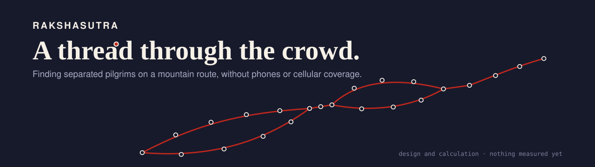
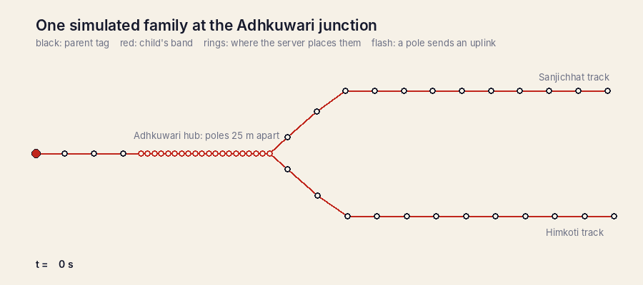
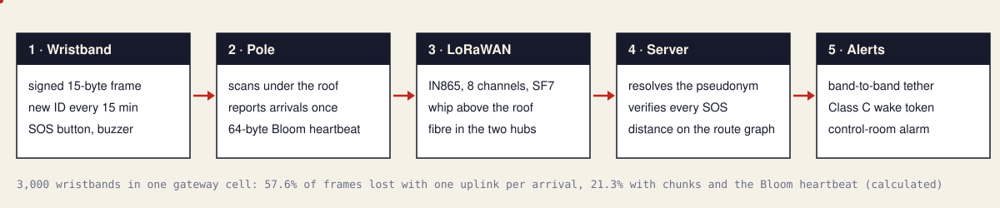
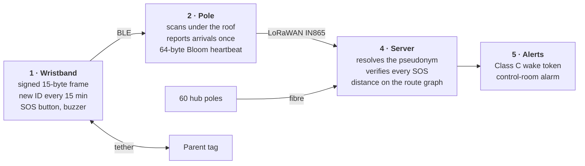
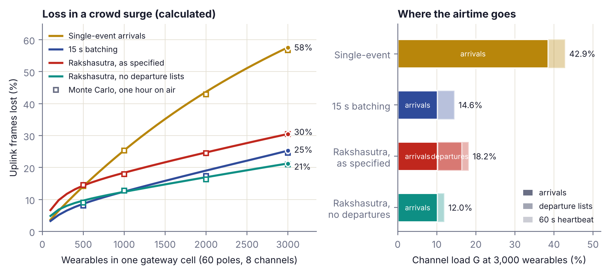
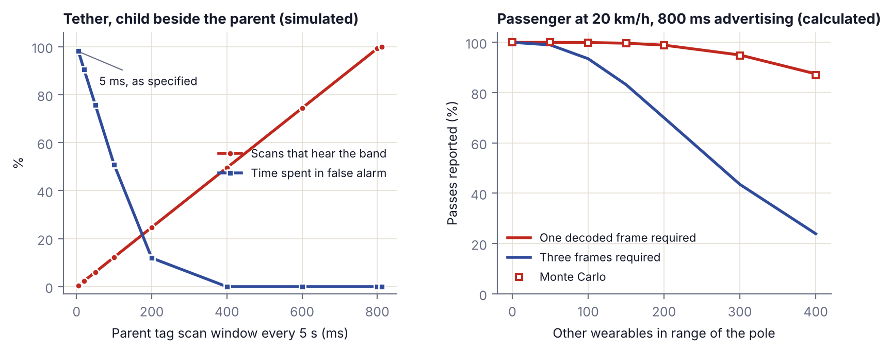
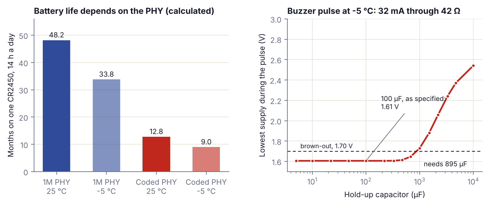
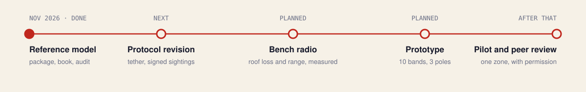

<p align="center"><picture><source media="(prefers-reduced-motion: reduce)" srcset="docs/banner.png"></picture></p>

<h1 align="center">Rakshasutra</h1>

<p align="center"><b>An open design for finding separated children and elders on a mountain pilgrimage route, without phones or cellular coverage. Every number recomputed by code you can run.</b></p>

<p align="center">
<a href="https://github.com/0xr4j/rakshasutra/actions"></a>


</p>

<p align="center">
<a href="https://0xr4j.github.io/rakshasutra/"><b>Website</b></a> ·
<a href="https://0xr4j.github.io/rakshasutra/explorer.html"><b>Open the explorer</b></a> ·
<a href="docs/A-Thread-Through-the-Crowd-Rakshasutra.pdf"><b>The book</b></a> ·
<a href="docs/Rakshasutra-White-Paper-WP01.pdf"><b>White Paper WP-01</b></a> ·
<a href="AUDIT.md"><b>The audit</b></a>
</p>

<p align="center"></p>

<p align="center"><sub>One simulated family at a junction. Every advertisement is a real signed frame, the poles run the real filter, and the server sees only 151 uplinks. It flags the separation 105 s after they part and raises the SOS 0.3 s after the button is pressed.</sub></p>

> [!IMPORTANT]
> **This is a design. Nothing has been built or measured.** Every result here is *calculated* from a stated model or *simulated* with a fixed seed, and says which. It is a design study, not a safety system.

---

## Contents

[Why we started](#why-we-started) · [Quickstart](#quickstart) · [How it works](#how-it-works) · [Where the numbers come from](#where-the-numbers-come-from) · [How we modelled it](#how-we-modelled-it) · [How we tested it](#how-we-tested-it) · [Results](#results) · [The audit](#the-audit) · [The mathematics](#the-mathematics) · [Firmware](#firmware) · [Python API](#python-api) · [Repository map](#repository-map) · [Reproduce everything](#reproduce-everything) · [Limits](#limits) · [Next](#next) · [Contributing and security](#contributing-and-security) · [Cite](#cite)

## Why we started

A family walks a crowded mountain path to a shrine. A child lets go of a hand. Phones are in a locker at the top of the hill, the network is down in the valley, and the path forks twice. The cards issued at the gate say that the child entered, and nothing more.

Four ordinary facts about such a route defeat the trackers you can buy: no usable cellular network, passive RFID cards that are seen only at gates, long steel rain shelters that block radio, and phone-free zones near the sanctum. Rakshasutra, named after the protective thread tied on a wrist, turns the problem round. A coin-cell wristband only announces itself over Bluetooth, with an identity that changes every 15 minutes and a signature the server can check. Poles that already stand along the shelters listen, filter what they hear, and forward it over LoRaWAN.

The design began as a white paper. When we set out to publish it with code, we found we could not reproduce all of its numbers. So this repository is two things: a reference model of the design, and an [audit](AUDIT.md) of the paper's first draft, with the corrected values used everywhere.

## Quickstart

```bash
git clone https://github.com/0xr4j/rakshasutra.git
cd rakshasutra
pip install -e .
rakshasutra trace examples/attack_log.csv --registry examples/registry.json
```

```text
Rakshasutra 2026.11  |  8 uplinks from 4 poles, 3700 s
     10.0 s  ARRIVED    band-0421    pole 130 adhkuwari   
     20.0 s  FORGED_SOS band-0421    pole 131 adhkuwari   MIC does not match; dropped
     21.0 s  FORGED_SOS band-0421    pole 131 adhkuwari   MIC does not match; dropped
     30.0 s  DROPPED                 pole 200 sanjichhat  unknown or stale pseudonym
     40.0 s  SOS        band-0421    pole 131 adhkuwari   priority alarm, MIC verified; heard by 1 pole(s), strongest here
     70.0 s  ARRIVED    band-0421    pole 250 bhairon     5173 m in 30 s, 172.4 m/s
     70.0 s  SUSPECT    band-0421    pole 250 bhairon     faster than any vehicle on the track; possible replay
   3700.0 s  DROPPED                 pole 250 bhairon     unknown or stale pseudonym
   3710.0 s  DROPPED                 pole 250 bhairon     unknown or stale pseudonym
  Last seen: band-0421 at pole 250 (bhairon), 70 s
  Dropped: 3 unknown or stale, 2 forged SOS
```

Forged alarms and stale frames are dropped. One replayed sighting is believed and flagged; that is a [stated limit](#limits). Other commands:

```bash
rakshasutra frame --key 000102030405060708090a0b0c0d0e0f --counter 17 --sos   # build a signed frame
rakshasutra capacity --tags 3000        # load and loss of one gateway cell, four designs
rakshasutra airtime --bytes 15 64 200   # LoRaWAN time on air
rakshasutra battery                     # battery life and the cold buzzer pulse
rakshasutra link                        # BLE and LoRa link budgets under the roof
rakshasutra audit --results results/summary.json   # the white paper, recomputed
rakshasutra trace examples/adhkuwari_separation.csv --registry examples/registry.json
```

```text
One gateway cell: 3,000 wearables, 60 poles, 8 channels, SF7   (analytical model)
  design                                    load   frames lost
  Raw forwarding                         1060.8%    100.0%   [####################]
  Single-event arrivals                    42.9%     57.6%   [############........]
  15 s batching                            14.6%     25.3%   [#####...............]
  Rakshasutra (as specified)               18.2%     30.5%   [######..............]
  Rakshasutra without departure lists      12.0%     21.3%   [####................]
    Raw forwarding: Raw BLE forwarding: every ping becomes an uplink
    Single-event arrivals: One uplink per arrival, plus a raw list of IDs every 60 s
    15 s batching: Arrivals batched every 15 s, plus a raw list of IDs every 60 s
    Rakshasutra (as specified): 25-tag arrival chunks, departure lists and a 64-byte Bloom heartbeat
```

## How it works

<p align="center"></p>

<details><summary>The same diagram as a Mermaid flowchart</summary>



</details>

The fifteen bytes a wristband sends every 800 ms:

```text
Frame (15 bytes)   5a ff 04 11 00 3c 34 fd c9 01 96 8c 83 e4 2f
  Company_ID     5a ff          0xFF5A, low byte first
  V_type         04             version 4, band
  Slot_Counter   11 00          slot 17 (255 min after power-on)
  Rolling_ID     3c 34 fd c9    changes every 15 minutes
  F_stat         01             SOS pressed
  B_mv           96             3.00 V
  MIC            8c 83 e4 2f    AES-CMAC over bytes 2 to 10
  Radio address  d4:1b:8a:54:a8:dc
```

A pole does four things with what it hears:

1. **Forwards an SOS at once**, whole, so the server can verify its signature. At most ten a minute.
2. **Reports each wristband once**, when it arrives, in chunks of at most 25 every 15 seconds.
3. **Summarises who is still there** every 60 seconds as a 64-byte Bloom filter, so a frame never exceeds the 222-byte limit however dense the crowd.
4. **Holds no keys.** A stolen pole reveals no identity and cannot forge a wristband.

## Where the numbers come from

There is no measured data yet. Every input is listed in [`data/params.csv`](data/params.csv) with its status:

| Status | Count | Meaning |
|---|---|---|
| `PAPER` | 78 | a design value from White Paper WP-01; not measured |
| `STANDARD` | 4 | fixed by a specification (LoRaWAN regional parameters, Bluetooth Core) |
| `DEFINED` | 5 | an encoding the paper left open and this repository had to fix |
| `ASSUMED` | 10 | no source; chosen so that a calculation can run, and flagged where used |

The route follows the white paper's model of the Shri Mata Vaishno Devi trek: 22.5 km in six zones, 255 poles, 762 m to 2,017 m. Pole positions within a zone are schematic ([`data/poles.csv`](data/poles.csv)); it is not a survey.

## How we modelled it

**The signed frame.** AES-128 and AES-CMAC written out in plain Python and in C, checked against the FIPS 197 and RFC 4493 vectors and against an independent library. Code: [`cmac.py`](src/rakshasutra/cmac.py), [`protocol.py`](src/rakshasutra/protocol.py).

**Radio.** The white paper's log-distance model under the steel roof, turned into a margin, a delivery probability and a range. Code: [`linkbudget.py`](src/rakshasutra/linkbudget.py).

**Airtime and capacity.** Exact LoRa time on air for every frame size; Poisson arrivals at each pole; four forwarding designs; pure-ALOHA loss with mixed frame lengths. Code: [`lora.py`](src/rakshasutra/lora.py), [`capacity.py`](src/rakshasutra/capacity.py).

**The pole and the server.** The edge filter of Algorithm 2 and the verification of Algorithm 1, as running code. Code: [`edge.py`](src/rakshasutra/edge.py), [`resolver.py`](src/rakshasutra/resolver.py), [`server.py`](src/rakshasutra/server.py).

**People and power.** The Class A delay, the tether's scan window, capture of passengers at 20 km/h, the current budget, and the supply during a buzzer pulse as an RC circuit. Code: [`kinematics.py`](src/rakshasutra/kinematics.py), [`power.py`](src/rakshasutra/power.py).

## How we tested it

Nothing can be checked in the field yet, so every formula is checked against something that does not use the formula:

| Check | Against | Code |
|---|---|---|
| Frame bytes | RFC 4493 and FIPS 197 vectors, an independent CMAC library, and the C core on 200 random keys | `tests/test_crypto.py`, `tests/test_firmware.py` |
| Collision formula | a Monte Carlo cell: every frame of an hour put on air, 695,304 frames; agreement within 1.7 points | `simulate.py` |
| Edge filter | the C core and the Python reference fed the same ten busy minutes; uplinks must be identical | `tests/test_firmware.py` |
| Bloom false positives | direct counting | `tests/test_bloom_and_edge.py` |
| Buzzer droop | a time-stepped integration of the circuit | `tests/test_models.py` |
| Tether and vehicle capture | Monte Carlo against the closed form | `simulate.py` |
| Browser explorer | its JavaScript kernel against Python, under Node | `tests/test_demo_parity.py` |
| The whole chain | a simulated family walk through 48 poles | `simulate.family_walk` |

**104 automated tests** also pin the headline numbers, keep `data/params.csv` in step with the package, and fail if a saved result no longer matches the code. All seeds are fixed, so a rerun reproduces every saved result exactly.

## Results

**A crowd surge in one gateway cell** <sub>(calculated; 60 poles, 8 channels, SF7)</sub>

| Forwarding design | Frames lost with 500 wristbands | with 3,000 |
|---|---|---|
| One uplink per arrival, raw ID list every 60 s | 14.1% | 57.6% |
| Arrivals batched every 15 s, raw ID list | 8.6% | 25.3% |
| Rakshasutra as first specified (chunks, departure lists, Bloom heartbeat) | 14.3% | 30.5% |
| **Rakshasutra without departure lists** | 9.7% | **21.3%** |

<p align="center"></p>

| Finding | Number |
|---|---|
| Airtime saved against one uplink per arrival | 72.1% (57.6% as first specified) |
| A raw ID list is too long for one frame | at 22% of poles with 3,000 wristbands in the cell; the Bloom heartbeat is always 64 bytes |
| Bloom heartbeat false positives | 1.6% with 50 wristbands at a pole, 8.7% with 100 |
| Loss in the deployed layout (about 32 poles per gateway, 5,000 wristbands on the route) | 7.3% |

**People who move**

| Check | Result |
|---|---|
| SOS, button to control room, under the 3,000-wristband surge <sub>(simulated)</sub> | median 0.5 s; 92% within 4 s; on fibre poles 95% within 0.6 s |
| Passenger at 20 km/h reported by a pole <sub>(calculated)</sub> | 99.7% with 150 other wristbands in range, 95.0% with 300 |
| Same passenger with accelerometer-gated slow advertising and a three-hit rule | at most 25% |
| Class A downlink in place of the tether and Class C | 173 s worst case: the person has walked 216 m |

<p align="center"></p>

**Radio and power** <sub>(calculated from design values)</sub>

| Check | Result |
|---|---|
| Bluetooth range under the roof at 98% delivery | 174 m on Coded PHY, 82 m on 1M PHY; poles stand up to 108 m apart |
| Same wristband heard by a pole mounted above the steel roof | 4.1 m |
| LoRa margin at 8 km behind one ridge | +16.1 dB with the whip above the roof, −4.4 dB with the antenna below it |
| Battery life on a CR2450, Coded PHY | 12.8 months at 25 °C, 9.0 at −5 °C |
| Battery life on 1M PHY | 48.2 months at 25 °C, 33.8 at −5 °C |

<p align="center"></p>

**In one sentence:** the limit of the system is LoRa airtime in a surge; batching does most of the work, a fixed-size Bloom filter keeps every frame legal, and three parts of the first design must change before hardware is built.

## The audit

The first draft of the white paper called its results empirical. Nothing had been measured. Each checkable number was recomputed from the paper's own equations and parameters:

| Verdict | Claims | Meaning |
|---|---|---|
| ✅ reproduced | 16 | the model gives the first draft's number |
| ✏️ differs | 16 | the model gives another number; the revised paper uses the model's |
| 🔧 design fix | 6 | the mechanism does not work as specified; the fix is stated |
| ❓ open | 4 | needs a datasheet check or a measurement |

The three mechanisms that do not work as first specified:

- **The tether's scan.** A 5 ms scan window every 5 s hears a band that advertises every 800 ms only 0.48% of the time, so the parent tag would be in false alarm 98% of the time. It needs 811 ms, or synchronised scanning.
- **The cold buzzer.** A 100 µF capacitor behind a 42 Ω cold cell has a 4.2 ms time constant against a 100 ms pulse. The supply falls to 1.61 V, below the chip's 1.70 V. It needs 895 µF, or a pulse under 29.8 mA.
- **Departure lists.** They cost more airtime than the Bloom heartbeat saves. The first draft's 15.8% loss at 3,000 wristbands is 30.5% as specified and 21.3% without them.

All 42 entries with notes: [AUDIT.md](AUDIT.md), or the [audit page](https://0xr4j.github.io/rakshasutra/audit.html).

## The mathematics

**The signed frame.** With tag key $K_u$ and slot counter $c$:

$$\mathrm{ID}_{u,c} = \mathrm{Trunc}_{32}\,\mathrm{CMAC}_{K_u}(\mathtt{0x01}\,\Vert\,c), \qquad \mathrm{MIC} = \mathrm{Trunc}_{32}\,\mathrm{CMAC}_{K_u}(\text{bytes } 2 \ldots 10)$$

**Expected counter at the server**, with a three-slot window around it:

$$\hat c_u(t) = \left(c_{init} + \left\lfloor \frac{t - t_{pair}}{900} \right\rfloor\right) \bmod 65536$$

**Received power under the roof** (log-distance, shadowing $X_\sigma$):

$$P_{rx}(d) = P_{tx} - PL(d_0) - 10\,n\,\log_{10}(d/d_0) - L_{body} - X_\sigma$$

**LoRa time on air** for an application payload of $B$ bytes at spreading factor $SF$, coding rate 4/5:

$$T(B) = \frac{2^{SF}}{BW}\left(20.25 + \max\left(\left\lceil \frac{8(13+B) - 4\,SF + 44}{4\,SF} \right\rceil \cdot 5,\ 0\right)\right)$$

**Pure ALOHA with mixed frame lengths.** A frame of length $T_i$ among streams of rate $\lambda_j$ and length $T_j$ on $M$ channels is lost with probability

$$P_{loss,i} = 1 - \exp\left(-\frac{1}{M}\Big(T_i \sum_j \lambda_j + \sum_j \lambda_j T_j\Big)\right)$$

which is $1 - e^{-2G}$ for equal frames.

**Bloom heartbeat**, 512 bits, three probes, $n$ wristbands: $P_{false} = \left(1 - e^{-3n/512}\right)^3$.

**The buzzer pulse.** A cell of voltage $V_0$ and internal resistance $R$, a hold-up capacitor $C$, a pulse of current $I$:

$$V(t) = V_0 - I R \left(1 - e^{-t/RC}\right)$$

The capacitor only helps while $t \ll RC$.

Full derivations, each worked through with numbers, are in [the book](docs/A-Thread-Through-the-Crowd-Rakshasutra.pdf).

## Firmware

[`firmware/`](firmware) holds a portable C99 core with no dynamic memory: AES-128, AES-CMAC, the signed frame, the wake token, the Bloom heartbeat, LoRa time on air, and the pole's edge filter.

```c
rs_pole pole;
rs_pole_init(&pole, 1, -75.0);                        /* transit track: one hit, -75 dBm gate */
rs_pole_on_adv(&pole, payload, 15, rssi, now, send, NULL);   /* every advertisement heard */
rs_pole_flush(&pole, now, send, NULL);                /* every 15 s: arrivals and departures */
rs_pole_heartbeat(&pole, send, NULL);                 /* every 60 s: 64-byte Bloom filter */
```

- `rakshasutra_pole/rs_core.c`, `rs_core.h`: the core; compiled with `-Wall -Wextra -Werror -pedantic` and compared byte for byte with Python by `tests/test_firmware.py`
- `host_test.c`: the harness that test drives
- `rakshasutra_pole/rakshasutra_pole.ino`: an ESP32-S3 sketch (Coded PHY scan, the core, LoRaWAN). **Reference only: not compiled in CI and never run on hardware.**

There is no wristband firmware yet.

## Python API

```python
from rakshasutra import Registry, build_frame, derive_tag_key, parse_frame

master = bytes(range(16))                               # demonstration key only
key = derive_tag_key(master, b"band-0421", b"salt")
frame = build_frame(key, counter=17, flags=0x01)        # SOS pressed
print(frame.hex(" "), parse_frame(frame).sos)

server = Registry()
server.register("band-0421", key, c_init=17, t_pair=0.0)
print(server.resolve_frame(pole=131, frame=frame, rssi_dbm=-62, t=30.0))
# Result(status='OK', uid='band-0421', sos=True, location=131)
```

```python
from rakshasutra import capacity, power, lora

cell = capacity.cell_load("rakshasutra", tags=3000, departures=False)
print(f"{cell.load:.3f} {cell.loss:.3f}")                # 0.120 0.213
print(f"{lora.time_on_air(64) * 1000:.2f} ms")           # 138.50 ms
print(power.pulse_droop(capacitor_uf=100)["brownout"])  # True
```

## Repository map

```
rakshasutra/
├── src/rakshasutra/       the reference model
│   ├── cmac.py · protocol.py   AES-CMAC; the signed frame, radio address and wake token
│   ├── resolver.py · server.py identity resolution (Algorithm 1) and the control room
│   ├── edge.py · bloom.py      the pole's edge filter (Algorithm 2) and the 64-byte heartbeat
│   ├── lora.py · capacity.py   time on air, ALOHA loss, load of a gateway cell
│   ├── linkbudget.py           BLE and LoRa budgets under the steel roof
│   ├── kinematics.py · power.py   alerts and moving people; battery and the cold pulse
│   ├── trek.py                 the route as a graph of 255 poles
│   ├── simulate.py             Monte Carlo checks and the end-to-end family walk
│   ├── audit.py · params.py    the audit; every parameter with its source
│   └── cli.py                  the `rakshasutra` command
├── firmware/              C core, host test, ESP32-S3 pole sketch
├── experiments/           one script per study, figures, README assets
├── tests/                 104 automated tests
├── data/                  parameters, zones and poles
├── results/               saved output of every study
├── generated/             numbers, tables and figures written from the results
├── examples/              a family walk and an attack log to replay
├── book/ · whitepaper/    LaTeX sources of the book and of WP-01
├── demo/                  sources of the website and the browser explorer
└── docs/                  website, explorer and PDFs (GitHub Pages)
```

## Reproduce everything

```bash
pip install -r requirements.txt && pip install --no-deps -e .
make test         # 104 tests, about 15 seconds; compiles the firmware core and runs the browser kernel
make results      # every study, a few seconds, all seeds fixed
make examples generated assets
make book whitepaper site
```

Every number in the book, the white paper, this README and the website is written from the result files by script, never typed by hand. This README is built from [`generated/README.tmpl.md`](generated/README.tmpl.md).

## Limits

- **Nothing is measured.** Roof loss, the path-loss exponent, body loss and the currents are design values. Every range and lifetime depends on them.
- **The route is schematic**, not a survey, and the work is not commissioned or endorsed by the Shrine Board.
- **Ordinary sightings are not authenticated.** Arrival reports carry no MIC, so a frame replayed at another pole inside its 45-minute slot window is believed. Only SOS frames are fully verified. The server flags impossible speeds.
- **A wristband can be followed within one 15-minute slot**, and whoever holds the server's master key can follow all of them.
- **The capacity model is simple and pessimistic:** Poisson movement, pure ALOHA, no capture effect, one spreading factor.
- **Bluetooth scanning in a dense crowd is barely modelled.** A real scanner following extended advertisements will do worse.
- **The latency of the Class C wake token is not modelled.**
- **The pole sketch has never run on hardware** and there is no wristband firmware.
- This is research software and a design study. It is not a safety system and must not be relied on as one.

## Next

<p align="center"></p>

The next number should be a measurement. Three inputs carry the radio chapter and can be measured in an afternoon under any galvanised iron shed: roof loss at 2.44 GHz and at 866 MHz, and the path-loss exponent beneath it. Timeline and rules fixed in advance: [ROADMAP.md](ROADMAP.md).

Have a GI shelter and an afternoon, experience with dense Bluetooth scanning, or a role in crowd safety? [Offer a measurement or field access](https://github.com/0xr4j/rakshasutra/issues/new?template=offer-data.yml).

## Contributing and security

Bug reports, measurements and pull requests are welcome; see [CONTRIBUTING.md](CONTRIBUTING.md). To report a security problem privately, including a weakness in the protocol, follow [SECURITY.md](SECURITY.md).

## Cite

```
Jha R. A Thread Through the Crowd. Rakshasutra: Design, Model and Audit.
Self-published, 2026. https://github.com/0xr4j/rakshasutra
```

Citation metadata is in [`CITATION.cff`](CITATION.cff). Code under the MIT licence; the book and white paper under CC BY 4.0. Neither has been peer reviewed.

<sub>Raj Jha · independent researcher</sub>
