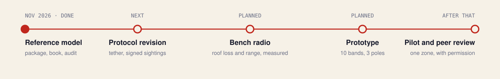

# Rakshasutra roadmap

Each stop ends in something finished and public. A peer-reviewed paper comes last, once measurements stand.

| When | Stop | Output | Status |
|---|---|---|---|
| November 2026 | Reference model | Python package and command line, C firmware core, Monte Carlo simulations, browser explorer, the book, White Paper WP-01 revision 2, and the audit of the first draft | Done |
| Next | Protocol revision | A synchronised tether, signed sightings, no departure lists, a channel reserved for SOS, a masked counter | Not started |
| Planned | Bench radio | Roof loss and range under a galvanised iron shed; scanner capacity with many beacons; currents of the chosen chip; a coin cell in the cold | Planned |
| Planned | Prototype | Ten bands, three poles, one gateway; the pole sketch brought up on hardware; wristband firmware | Planned |
| After that | Pilot | One zone of a real route, with the authority's permission and a legal review under the DPDP Act | Planned |
| After that | Peer review | A paper built on measurements | Planned |

## Why the protocol must be revised first

The audit of the first draft found mechanisms that do not work as specified. Building hardware around them would waste it.

- **The tether cannot scan for 5 ms every 5 s.** It would almost never hear the band. A window long enough to be certain costs 25 times the band's whole power budget. Bluetooth periodic advertising lets the listener wake exactly when a packet is due; the same fix serves the band's scan for wake tokens.
- **Ordinary sightings can be replayed.** Carrying the 4-byte MIC in each arrival tuple and verifying it at the server closes this, at 16 wristbands a chunk in place of 25.
- **Departure lists cost more airtime than they are worth.** Departure is already implied by the next arrival and by the heartbeat.
- **An SOS shares its channels with routine traffic.** One of the eight channels kept clear for alarms would bring nearly every SOS in on the first attempt.
- **The buzzer browns out in the cold.** The pulse current must come down, or the capacitor must grow tenfold.
- **The radio chip named in the paper is specified to +4 dBm, not +8 dBm.** The part and its currents must be fixed from datasheets.

## Rules fixed in advance

- Measured results are reported beside the calculated ones, whichever way they fall.
- Calculated results are labelled calculated, simulated results simulated. A result is called measured only when the raw data are in `data/`.
- Every number in a report is written from result files by script.
- A change to the model that moves a headline number changes the pinned test in the same commit, with the reason.
- No personal data about any real pilgrim enters this repository.

## Open tasks

- [x] AES-CMAC and frame layout pinned against RFC 4493 and the C core
- [x] Capacity model checked against Monte Carlo
- [x] Edge filter in C, compared byte for byte with Python
- [x] Every checkable number of the first draft audited
- [x] Browser explorer in step with the Python reference
- [ ] Periodic-advertising tether: model, then firmware
- [ ] Signed arrival tuples; capacity recomputed
- [ ] Layer 2 wake-token latency modelled
- [ ] Bluetooth scanner capacity in a dense crowd modelled, then measured
- [ ] Roof loss and path-loss exponent measured under a GI shed
- [ ] Pole sketch brought up on an ESP32-S3 with an SX1262
- [ ] Wristband firmware

## What would help

| Need | Why |
|---|---|
| A galvanised iron shelter, two BLE boards and a LoRa pair for an afternoon | the three radio parameters everything rests on |
| Experience with extended-advertising scanning at hundreds of devices | the least-modelled part of the design |
| A cold chamber or a winter night, and a few CR2450 cells | internal resistance and the buzzer pulse |
| People who run crowd safety at a shrine or a large gathering | whether the design answers the real problem |

Have any of these? Open an issue with the "Offer a measurement or field access" form.
